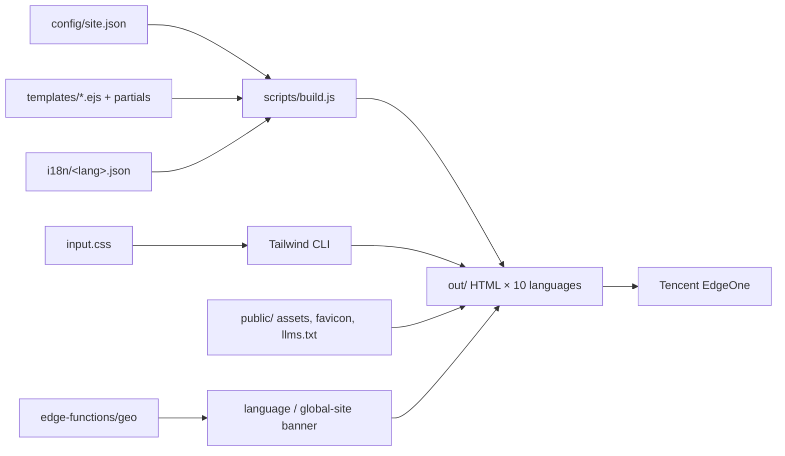

# UChat AI website

Read this in other languages: [English](README.md) | [简体中文](README_CN.md)

Static source of <https://uchat.cn> — the standalone UChat AI product landing page,
split out of the FoxTerm marketing site. Everything is generated: EJS templates ×
per-language JSON packs → minified multilingual HTML in `out/`.

UChat AI is a 100% native AI chat app for macOS, iPhone and iPad. This repo only
hosts the landing page. Privacy Policy, Terms of Service, About and Contact stay on
<https://foxterm.app> (joint FoxTerm + UChat documents) and are linked externally —
there are no legal pages in this repo, and `npm run check` fails if a dead internal
link to one appears.

## Languages

10 locales, default `en`, served from language directories (`/`, `/zh-hans/`, `/ja/`, …):
English, 简体中文, 繁體中文, 日本語, Deutsch, Русский, Français, Español, 한국어, Português (Brasil).

## Build

```bash
npm install
npm run build     # templates × i18n → out/ (+ tailwind, sitemap.xml, robots.txt)
npm run check     # QA: copy coverage, SEO URLs, assets, minify, external-link rules
npm run serve     # preview out/ at http://localhost:8080
```

`npm run build` also compiles Tailwind v4 from `input.css` (it scans
`templates/**/*.ejs` for used classes) and copies `public/` into `out/`.

## Layout



| Path                  | Purpose                                                                     |
| --------------------- | --------------------------------------------------------------------------- |
| `config/site.json`    | baseUrl, languages, page/nav/footer/product tables, SEO meta defaults       |
| `templates/index.ejs` | the landing page (hero, features, tools, providers, pricing, FAQ, download) |
| `templates/404.ejs`   | English-only 404 (not localized, so no hreflang alternates)                 |
| `templates/partials/` | `head`, `nav`, `footer`, `langSwitcher`                                     |
| `i18n/<lang>.json`    | `_meta`, `_shared`, `index`, `_seo` for one language                        |
| `scripts/build.js`    | render → minify HTML → terser inline JS → Tailwind → sitemap/robots         |
| `scripts/check.js`    | post-build invariants; run it after every content change                    |
| `public/`             | favicon set, images, `style.css`, `script.js`, `llms.txt`                   |
| `edge-functions/geo/` | returns visitor country to the browser, CORS allow-list                     |
| `edgeone.json`        | EdgeOne build command, output dir, `/zh*` → `/zh-hans                       | zh-hant` 301s |

## Conventions

- Copy lives in arrays, flattened to dotted keys: `hero.title = ["…", "…"]` is read as
  `t["hero.title.0"]`, `t["hero.title.1"]`. Missing keys fall back to English at build time,
  so a new key can be added to `en.json` first and translated afterwards.
- Every locale must stay complete: add a key to all 10 packs (or accept the English fallback),
  then run `npm run check` — it reports any value that never renders.
- Internal links are localized automatically (`/zh-hans/…`); anything starting with `http(s):`,
  `//` or `#` is left untouched. Cross-product and legal links therefore go in `config/site.json`
  as absolute `https://foxterm.app/…` URLs.
- Downloads are hardcoded in the `#download` block of `templates/index.ejs`: the App Store
  listing and the notarized macOS disk image
  `https://github.com/foxterm/UChat/releases/latest/download/UChat.dmg`. `npm run check` fails
  if either link is missing from a locale. Sparkle picks up `public/appcast.xml`, which is
  copied to `/appcast.xml`.
- Copyright years are never hardcoded: `script.js` rewrites `[data-copyright-year]` to
  `2026–<current year>`.
- hreflang alternates and `x-default` are generated from `config/langs` and stay inside
  `uchat.cn`; the global UChat page at `https://foxterm.app/uchat` is linked from the footer
  and from the region banner only.
- The language banner prefers a same-site language switch; it only suggests
  `https://foxterm.app/uchat` when the visitor's recommended language is English and the page
  is already English.

## Deploy

Tencent EdgeOne runs `npm run build` and serves `./out`. `edge-functions/geo/index.ts`
exposes `/geo`; its CORS allow-list covers `foxterm.app`, `foxterm.cn` and `uchat.cn`.
Locally `/geo` is absent, so the banner simply stays hidden.
