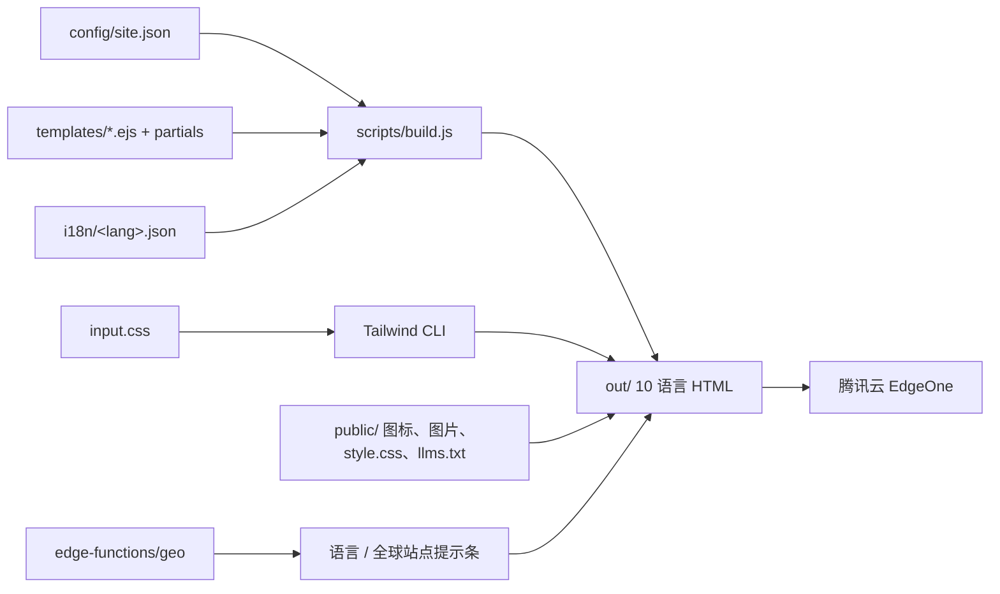

# UChat AI 官网

其他语言：[English](README.md) | [简体中文](README_CN.md)

<https://uchat.cn> 的静态站点源码——从 FoxTerm 官网中独立出来的 UChat AI 产品落地页。
全站由生成器产出：EJS 模板 × 各语言 JSON 文案包 → 压缩后的多语言 HTML 输出到 `out/`。

UChat AI 是一款 100% 原生的 macOS / iPhone / iPad AI 聊天应用。本仓库只承载落地页：
隐私政策、服务条款、关于我们、联系方式仍放在 <https://foxterm.app>（FoxTerm 与 UChat 的联合文档），
站内一律外链过去。仓库里没有协议页面，一旦出现指向本站不存在的协议页面死链，`npm run check` 会直接失败。

## 语言

10 种语言，默认 `en`，按语言目录发布（`/`、`/zh-hans/`、`/ja/` …）：
English、简体中文、繁體中文、日本語、Deutsch、Русский、Français、Español、한국어、Português (Brasil)。

## 构建

```bash
npm install
npm run build     # templates × i18n → out/（含 tailwind、sitemap.xml、robots.txt）
npm run check     # 质检：文案覆盖、SEO 链接、静态资源、压缩结果、外链约定
npm run serve     # 本地预览 out/，默认 http://localhost:8080
```

`npm run build` 会用 `input.css` 编译 Tailwind v4（扫描 `templates/**/*.ejs` 收集用到的类名），
并把 `public/` 素材复制进 `out/`。

## 目录结构



| 路径                  | 作用                                                          |
| --------------------- | ------------------------------------------------------------- |
| `config/site.json`    | baseUrl、语言表、页面/导航/页脚/产品表、SEO 默认 meta         |
| `templates/index.ejs` | 落地页正文（首屏、特性、工具、供应商、定价、FAQ、下载）       |
| `templates/404.ejs`   | 仅英文的 404（不做语言化，因此不输出 hreflang）               |
| `templates/partials/` | `head`、`nav`、`footer`、`langSwitcher` 四个片段              |
| `i18n/<lang>.json`    | 单语言的 `_meta`、`_shared`、`index`、`_seo`                  |
| `scripts/build.js`    | 渲染 → HTML 压缩 → 内联 JS terser → Tailwind → sitemap/robots |
| `scripts/check.js`    | 构建后不变量校验，改完文案必须跑                              |
| `public/`             | favicon 全套、图片、`style.css`、`script.js`、`llms.txt`      |
| `edge-functions/geo/` | 给浏览器返回访客国家，含 CORS 白名单                          |
| `edgeone.json`        | EdgeOne 构建命令与输出目录，`/zh*` → `/zh-hans                | zh-hant` 的 301 |

## 约定

- 文案写成数组，构建时展平成点号 key：`hero.title = ["…", "…"]` 对应 `t["hero.title.0"]`、
  `t["hero.title.1"]`。缺失的 key 在构建时回退英文，所以新 key 可以先只加到 `en.json`，随后补翻译。
- 新增文案要覆盖全部 10 个语言包（或接受英文回退），然后跑 `npm run check`——它会报出任何从未被渲染的值。
- 站内链接自动加语言前缀（`/zh-hans/…`）；以 `http(s):`、`//`、`#` 开头的链接原样保留。
  因此跨产品与协议链接在 `config/site.json` 里写成绝对地址 `https://foxterm.app/…`。
- 版权年份不写死：`script.js` 会把 `[data-copyright-year]` 改成 `2026–<当前年>`。
- hreflang 与 `x-default` 由 `config/langs` 生成，全部指向 `uchat.cn` 自己；
  全球站页面 `https://foxterm.app/uchat` 只出现在页脚镜像行和地区提示条里。
- 提示条优先建议切换本站语言；只有当访客地区推荐语言是英文、且当前页已是英文时，
  才提示切换到 `https://foxterm.app/uchat`。

## 部署

腾讯云 EdgeOne 执行 `npm run build` 并托管 `./out`。`edge-functions/geo/index.ts` 提供 `/geo`，
其 CORS 白名单包含 `foxterm.app`、`foxterm.cn`、`uchat.cn`。本地没有 `/geo`，提示条会自动隐藏。
